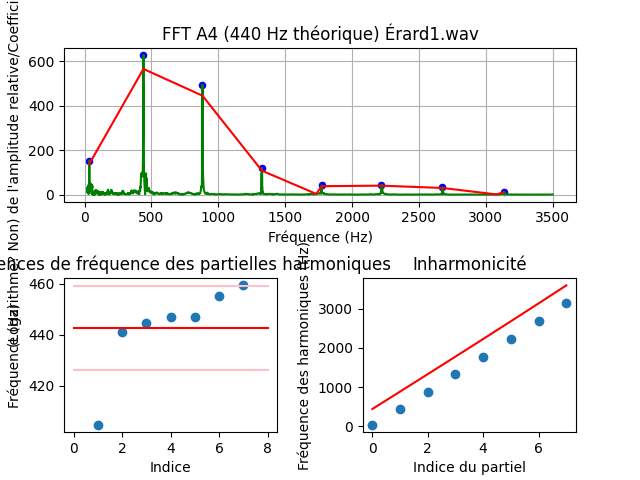

# Guide d'utilisation
Allô !
J'ai beaucoup aimé travailler sur ce sujet. J'aime l'acoustique ! C'est tellement beau !

Alors dans ce dossier il y a 3 fichiers:
1. ```Data_Import_and_Transformation.py``` : c'est assez *straightforward* comme fichier. Il lit les donnees et les classe dans un dictionnaire (avec les accolades {  }   ) selon le nom du piano. 
    - <span style="font-size: 1.25em;">CHOSE À RETENIR !!!</span>    les noms des pianos sont sans accent !!! Souvent en Python, ça évite des bugs...
2. ```FFT.py``` : le fichier calcule la FFT, applique les transformations logarithmiques nécessaires pour plus de lisibilité, et génère les données pour le graphe 3D. C'est aussi dans ce fichier que tu trouveras la fonction pour générer le graphique 3D. Les paramètres importants à comprendre sont $K$, $STEP$, $DT$ et $DF$.
3. ```Analyse_des_donnees.py``` : te permet de cibler une fréquence pour un certain piano et d'en sortir les données. Tu peux y spécifier grâce aux variables en haut le piano d'intérêt, et jouer avec F_INT pour modifier les fréquences d'intérêt.

### Mon *take*
En soi, je ne crois pas avoir poussé l'analyse beaucoup plus loin que toi, **ce que tu as généré avec ton code est déjà excellent.** Je pense que les notions de fréquence maximale et de résolution fréquentielle lors de la transformée de Fourier sont importantes à comprendre pour des calculs comme ceux-là. Leurs équations sont indiquées juste en bas ici :) .


# Équations

- avec sp.fft.rfftfreq, 
    - les fréquences en sortie vont toujours de 0 à la fréquence de Nyquist ($f_{max} = \frac{1}{2 \cdot dt}$)
    - la précision en fréquences est de $step = \frac{1}{k \cdot dt}$
    - Par exemple, avec $k=2000$ et $dt = 2.08 \cdot 10^{-5}$, on obtient $f_{max} = 17838$ et $step = 17.838 Hz$
    - On devrait monter à environ $k=8000$ pour obtenir une résolution en fréquences qui soit raisonnable (environ $4.5 Hz$)

# Notes sur l'acoustique
## Transformations logarithmiques
- En général, on applique des tranformations logarithmiques à toutes les valeurs d'amplitudes et de fréquences. Pourquoi ? Parce que l'oreille humaine est sensible de façon logarithmique, autant en amplitude qu'en fréquences. Le profil des courbes et des surfaces dans les graphiques nous parlent donc davantage. 
## Filtres dBZ -> dBA
- Chose intéressante aussi, notre oreille est moins sensible aux basses fréquences qu'aux hautes. Cela semble intuitif pour un musicien comme toi, mais pour un ingénieur: comment le quantifier ? Eh bien, certains filtres ont été développés avec le temps pour rendre compte sur les données et graphiques de la sensibilité atténuée de l'oreille aux basses fréquences. Il s'agit du filtre dBZ -> dBA. Les dBA sont les valeurs d'amplitude se rapprochant le plus de l'oreille humaine. À voir les graphiques 3D, on dirait que tes données ont été acquises en dBZ. Il faudrait donc appliquer un filtre vers dBA pour que ça corresponde à l'expérience humaine. Or, si ton projet est davantage physique et scientifique, ou que les normes pour les accordeurs de piano, bref, tout ça est en dBZ (communément appelé "dB"), alors ne te soucie pas de faire la transformation dBZ -> dBA.
    - Si le cas advenait où tu devais le faire, il faudrait:
        1. [Trouver les poids dBZ -> dBA sur le Web](https://www.nti-audio.com/en/support/know-how/frequency-weightings-for-sound-level-measurements)
        2. Convertir l'échelle actuelle de tes (ou mes) graphiques non seulement en logarithmique, mais en dB, avec la formule $dB(p) = 20 \cdot log_{10}(p/10^{-12})$ Peu importe que ce soit une valeur exacte, le filtre fera correctement son effet dans tous les cas. Je ne sais pas exactement comment convertir des valeurs de variations en dB. Ce sera des recherches à faire de ton côté.
        3. L'acoustique, c'est vaste ! Fais-moi signe si tu as d'autres questions.




- Dans le premier des graphiques ci-haut, c'est parfois intéressant d'avoir les amplitudes en échelle logarithmique. Souvent, ça fait des droites !! Plus facile à analyser par après quand le tout est linéaire.
- Mais peut-être que ce n'est pas le cadre de ton analyse.
